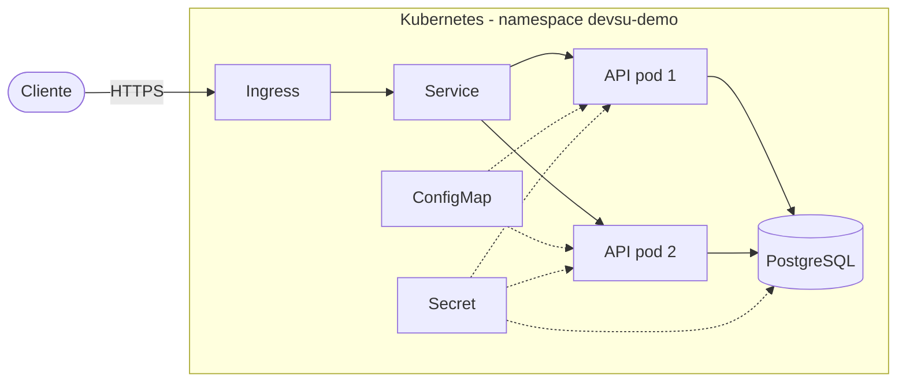
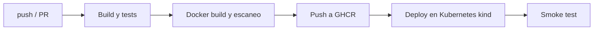

# Devsu Demo DevOps – Node.js

API REST de usuarios hecha con Node.js, Express y PostgreSQL. Está dockerizada, tiene un pipeline en GitHub Actions y se despliega en Kubernetes.

- Repositorio: https://github.com/carlodaniel-dev/devops-nodejs
- Pipeline: https://github.com/carlodaniel-dev/devops-nodejs/actions

## Contenido
1. [Arquitectura](#1-arquitectura)
2. [Cambios sobre la app original](#2-cambios-sobre-la-app-original)
3. [Ejecutar en local](#3-ejecutar-en-local)
4. [Docker](#4-docker)
5. [Pipeline CI/CD](#5-pipeline-cicd)
6. [Kubernetes](#6-kubernetes)
7. [Para producción](#7-para-producción)
8. [Lo que no se cumplió y por qué](#8-lo-que-no-se-cumplió-y-por-qué)
9. [Evidencias](#9-evidencias)
10. [API](#10-api)

---

## 1. Arquitectura



Si la carga sube, el HPA agrega más pods (de 2 hasta 5).

## 2. Cambios sobre la app original

| Antes | Ahora | Motivo |
|---|---|---|
| SQLite | PostgreSQL | Con varias réplicas, cada pod tendría su propia base de datos |
| `sync({ force: true })` en cada arranque | Migración en un `initContainer` | `force: true` borra las tablas en cada reinicio |
| Puerto fijo | Variable `PORT` | Configurable por entorno |
| Sin chequeos de salud | `/health` y `/ready` | Los usan Kubernetes y Docker |
| `.env` en el repo | `.env.example` | No subir credenciales |
| `dotenv` como dependencia de desarrollo | Se quitó | La imagen de producción fallaba al arrancar |

## 3. Ejecutar en local

Requisitos: Node.js 20.6 o superior y Docker.

**Con Docker Compose (API + base de datos):**
```bash
docker compose up --build
curl http://localhost:8000/health
```

**Pruebas y análisis:**
```bash
npm ci
npm test
npm run test:coverage
npm run lint
```

## 4. Docker

Archivo: [`Dockerfile`](./Dockerfile)

- Build en dos etapas (imagen final más liviana).
- Imagen base `node:22-alpine`.
- Corre con usuario no root (`node`).
- Variables de entorno: `NODE_ENV`, `PORT`, y las credenciales de la base de datos solo al ejecutar.
- Puerto 8000 y `HEALTHCHECK` sobre `/health`.
- Se eliminan npm, yarn y corepack de la imagen final porque no se usan al ejecutar.
- `.dockerignore` para dejar fuera archivos innecesarios.

```bash
docker build -t devsu-demo-api .
```

## 5. Pipeline CI/CD

Archivo: [`.github/workflows/ci-cd.yml`](./.github/workflows/ci-cd.yml)



| Paso | Qué hace |
|---|---|
| Code Build | `npm ci` |
| Análisis estático | ESLint |
| Pruebas unitarias | Jest |
| Cobertura | Mínimo 80 % |
| Auditoría de dependencias | `npm audit` |
| Validación de manifiestos | kustomize + kubeconform |
| Docker build | Buildx con caché |
| Escaneo de vulnerabilidades | Trivy (falla con HIGH/CRITICAL) |
| Push de la imagen | GitHub Container Registry (GHCR) |
| Deploy a Kubernetes | Clúster kind creado en el runner |
| Smoke test | Crea y consulta un usuario en la API |

El despliegue del pipeline se hace en un clúster **kind temporal** dentro del runner de GitHub, porque los runners no pueden acceder a un minikube local.

**Configuración opcional:**

| Nombre | Uso |
|---|---|
| `SONAR_TOKEN` (secret) | Activa el análisis en SonarCloud |
| `DEPLOY_TO_CLUSTER=true` (variable) | Activa el deploy a un clúster real |
| `KUBE_CONFIG` y `DB_PASSWORD` (secrets) | Necesarios solo para el deploy a un clúster real |

## 6. Kubernetes

Manifiestos en [`k8s/`](./k8s) (con kustomize).

| Recurso | Detalle |
|---|---|
| Namespace | `devsu-demo` |
| Deployment | 2 réplicas, actualización sin caída, probes y límites de recursos |
| ConfigMap | Configuración no sensible |
| Secret | Credenciales de la base de datos (se crea con un script, no se sube al repo) |
| Service | ClusterIP, puerto 80 → 8000 |
| Ingress | NGINX con TLS, host `devsu-demo.local` |
| HPA | Escala de 2 a 5 réplicas al 70 % de CPU |
| PodDisruptionBudget | Mantiene al menos 1 pod disponible |
| NetworkPolicy | Limita quién puede conectarse a la API y a la base de datos |
| PostgreSQL | StatefulSet con volumen de 1 Gi |

### Desplegar en minikube

Requisitos: `minikube`, `kubectl`, `kustomize`, `openssl` y Docker.

```bash
minikube start --cpus=2 --memory=4096
bash scripts/deploy-local.sh
```

Luego agrega el host a `/etc/hosts`:

```bash
echo "$(minikube ip)  devsu-demo.local" | sudo tee -a /etc/hosts
```

Probar:

```bash
curl -k https://devsu-demo.local/health
curl -k https://devsu-demo.local/api/users
```

> Con el driver Docker en macOS o Windows, ejecuta `minikube tunnel` y usa `127.0.0.1 devsu-demo.local` en `/etc/hosts`.

### Probar el escalamiento

```bash
kubectl -n devsu-demo get hpa -w
```

En otra terminal, genera carga:

```bash
kubectl -n devsu-demo run load --rm -it --image=busybox:1.36 --restart=Never -- \
  sh -c 'while true; do wget -q -O- http://devsu-demo-api/api/users >/dev/null; done'
```

## 7. Para producción

Lo que se agregaría en un entorno real:

- DNS apuntando al balanceador del Ingress.
- Certificado TLS con cert-manager y Let's Encrypt.
- Base de datos administrada (RDS, Cloud SQL, etc.).
- Manejo de secretos con Vault o External Secrets.
- Monitoreo con Prometheus y Grafana.
- Entornos separados (dev, staging, prod).

## 8. Lo que no se cumplió y por qué

| Requerimiento | Motivo |
|---|---|
| URL pública del endpoint | No se cuenta con infraestructura en la nube |
| Terraform en un proveedor público (punto extra) | No se cuenta con recursos en la nube |
| SonarCloud | Está implementado pero solo corre si se define `SONAR_TOKEN` |
| Deploy a un clúster real desde el pipeline | Implementado pero desactivado por defecto; requiere un clúster accesible desde internet |

## 9. Evidencias

- Pipeline: https://github.com/carlodaniel-dev/devops-nodejs/actions
- Capturas en la carpeta [`docs/`](./docs):
  - Pipeline en verde.
  - `kubectl get pods,svc,ingress,hpa -n devsu-demo`.
  - Respuesta de la API con `curl`.

## 10. API

| Método | Ruta | Descripción | Respuestas |
|---|---|---|---|
| GET | `/health` | Estado de la app | 200 |
| GET | `/ready` | Estado de la app y la base de datos | 200 / 503 |
| GET | `/api/users` | Lista los usuarios | 200 |
| GET | `/api/users/:id` | Obtiene un usuario | 200 / 400 / 404 |
| POST | `/api/users` | Crea un usuario | 201 / 400 |

Ejemplo:

```bash
curl -k -X POST https://devsu-demo.local/api/users \
  -H 'Content-Type: application/json' \
  -d '{"dni":"1234567890","name":"Ana"}'
```

## Licencia

Copyright © 2023 Devsu. All rights reserved.